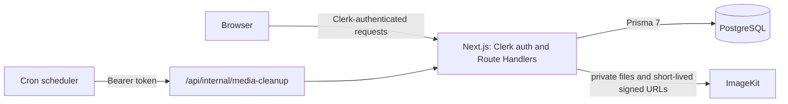

# My Album

My Album helps photographers organize albums and securely share photo galleries
with clients.
It is also a production-minded Next.js/Postgres project for practicing cloud
deployment, migrations, containers, and CI/CD.

[](https://github.com/nathandabre/my-album/actions/workflows/ci.yml)

## Features

- Public, unlisted, and password-protected albums with optional expiry.
- Guest favorites and album-level download controls.
- New private ImageKit uploads served through access checks and short-lived
  signed URLs.
- Per-user upload quotas and a durable media-cleanup worker with retries.

**Live demo:** [Add the deployed URL](https://your-live-demo.example)

## Screenshots

Capture these pages and save them at the listed paths:

| Page | Screenshot placeholder |
| --- | --- |
| Landing page | `docs/screenshots/landing.png` |
| Dashboard | `docs/screenshots/dashboard.png` |
| Album editor | `docs/screenshots/album-editor.png` |
| Public gallery | `docs/screenshots/public-gallery.png` |
| Password gate | `docs/screenshots/password-gate.png` |

## Architecture

- Next.js 16 App Router is the only application/API service.
- Clerk is the authentication source of truth; server actions and Route
  Handlers verify the Clerk session and database ownership.
- Prisma 7 with PostgreSQL stores users, albums, media metadata, and password
  attempt lockouts.
- Album uploads are streamed through an authenticated Next.js Route Handler.
  The server chooses the ImageKit folder, filename, and private setting; client
  upload fields are not forwarded. New uploads are checked against ImageKit
  metadata before photo records are created.
- ImageKit files are delivered through access-checked Next.js routes using
  short-lived signed ImageKit URLs.
- Media deletions are durably queued in PostgreSQL and retried by a
  secret-protected cleanup Route Handler.
- Album access tokens and guest-session cookies are signed with a purpose-bound
  HMAC derived from the server-only Clerk secret. Passwords use bcrypt.
- The previous Express service duplicated app behavior and trusted
  `x-user-id`; it has been removed. No in-repository application code called it.



The Content Security Policy is currently report-only while browser routes and
Clerk/ImageKit integrations are validated; it is not yet enforced.

## Key engineering decisions

- Album access cookies are HMAC-signed and bind the album ID and `updatedAt`
  revision, so editing an album invalidates old tokens.
- Password failures are stored per album/client key in PostgreSQL and trigger a
  bounded lockout after five failures in a 15-minute window.
- Upload folders, filenames, and private-file flags are chosen server-side;
  uploaded content is checked by file signature rather than trusting its MIME
  header.
- Media deletions enter a durable PostgreSQL queue in the same transaction as
  related record changes, then retry with backoff through an authenticated
  worker.
- Database changes use additive Prisma migrations; deployments apply them with
  `prisma migrate deploy` rather than resetting or pushing schema state.

## Environment

Copy `.env.example` to `.env` for local development. Do not commit `.env` or
place server-only values in `NEXT_PUBLIC_*` variables.

| Variable | Purpose | Exposure |
| --- | --- | --- |
| `DATABASE_URL` | PostgreSQL connection string | Server-only |
| `NEXT_PUBLIC_CLERK_PUBLISHABLE_KEY` | Clerk browser SDK | Public |
| `CLERK_SECRET_KEY` | Clerk server SDK and signing-key source for album/guest tokens | Server-only |
| `NEXT_PUBLIC_CLERK_SIGN_IN_URL` | Sign-in route | Public |
| `NEXT_PUBLIC_CLERK_SIGN_UP_URL` | Sign-up route | Public |
| `NEXT_PUBLIC_CLERK_SIGN_IN_FALLBACK_REDIRECT_URL` | Default sign-in redirect | Public |
| `NEXT_PUBLIC_CLERK_SIGN_UP_FALLBACK_REDIRECT_URL` | Default sign-up redirect | Public |
| `NEXT_PUBLIC_IMAGEKIT_PUBLIC_KEY` | ImageKit public key | Public |
| `NEXT_PUBLIC_IMAGEKIT_URL_ENDPOINT` | ImageKit delivery endpoint | Public |
| `IMAGEKIT_PRIVATE_KEY` | ImageKit metadata, delete, and signed-URL API access | Server-only |
| `CRON_SECRET` | Bearer secret for the scheduled media-cleanup worker | Server-only |

`CLERK_SECRET_KEY`, `IMAGEKIT_PRIVATE_KEY`, and `CRON_SECRET` must be configured
in the hosting provider's encrypted environment settings, not source control.
Password failures share a persisted per-album lockout bucket and do not trust
client-supplied forwarded-IP headers.

## Local setup

1. Use Node.js 22 or newer and install the locked dependencies:

   ```bash
   npm ci
   ```

2. Configure PostgreSQL, Clerk, and ImageKit using `.env.example`.
3. Generate the Prisma Client:

   ```bash
   npm run db:generate
   ```

4. Apply committed migrations:

   ```bash
   npm run db:migrate:deploy
   ```

   For an existing database or migration-baselining guidance, see
   [docs/operations.md](docs/operations.md). Never use `db push` or reset a
   database containing data.
5. Start the app:

   ```bash
   npm run dev
   ```

## Local Docker stack

Copy `.env.example` to `.env`, set `POSTGRES_PASSWORD`, and point `DATABASE_URL`
at the Compose service host `postgres` using the same database credentials.
Fill in the Clerk and ImageKit values to exercise authenticated and media flows.
Then run:

```bash
docker compose up --build
```

Compose starts PostgreSQL, applies pending migrations in a one-shot service,
then starts the app at `http://localhost:3000`. Check
`http://localhost:3000/api/health` for database readiness. The named database
volume persists when containers stop; do not remove it unless you intentionally
want to delete local data.

## Validation scripts

| Script | Purpose |
| --- | --- |
| `npm run lint` | ESLint |
| `npm run typecheck` | TypeScript check |
| `npm test` | Isolated unit tests |
| `npm run build` | Generate Prisma Client and build the production app |
| `npm run db:migrate:deploy` | Apply committed migrations in a deployment |
| `npm run db:migrate` | Create/apply a migration in local development |
| `npm run db:studio` | Open Prisma Studio |
| `npm run test:integration` | PostgreSQL integration tests (requires `TEST_DATABASE_URL`) |
| `npm run test:e2e` | Playwright public-route smoke tests (requires isolated `E2E_BASE_URL`) |
| `npm run media:migrate:dry-run` | Report public media without changes |
| `npm run media:migrate:apply -- --limit=25` | Explicitly migrate a bounded media batch |

Do not use `db:push` for production deployments. Do not reset or recreate a
production database.

See [docs/operations.md](docs/operations.md) for existing-media migration and
cleanup-worker operations.

For browser smoke tests, install Chromium and explicitly target a disposable
local or staging deployment:

```bash
npx playwright install chromium
E2E_BASE_URL=http://127.0.0.1:3000 npm run test:e2e
```

The Playwright configuration does not start a server automatically, so tests
cannot silently bind to whatever database happens to be in `.env`. The current
browser tests cover the public landing page, auth route availability, and
unauthenticated dashboard redirect. Full Clerk account creation, media upload,
sharing, password-gate, and download journeys still require a dedicated
Clerk/ImageKit staging setup and are not represented as verified here.

## Operational guides

See [docs/operations.md](docs/operations.md) for safely baselining an existing
database, migrating existing public ImageKit media, and scheduling/retrying the
durable media-cleanup worker.

Configure a scheduler to call `GET /api/internal/media-cleanup` periodically
with `Authorization: Bearer <CRON_SECRET>`. Failed jobs can be retried by
calling the same route with `POST` and a JSON body
`{"retryJobIds":["<job-id>"]}`. Keep the secret in the scheduler's encrypted
settings. The worker does not need Redis or a separately running process.

## Deployment

1. Provision PostgreSQL and take a verified backup before the first migration.
2. Configure the Clerk application for the production domain and add all Clerk
   and ImageKit variables from the table above to the deployment environment.
3. Confirm the ImageKit account permits private files and signed delivery.
   Uploads pass through the app server, which chooses the folder, filename, and
   `isPrivateFile: true` setting. Registration verifies ImageKit's file
   details, actual file signature, album folder, dimensions, size, and video
   duration before inserting metadata. The hosting platform must support the
   configured maximum request size and execution duration; some serverless
   platforms impose limits below the app's 2 GB video cap.
4. Deploy using the lockfile, then run `npm run db:migrate:deploy` against the
   intended database. The checked-in migrations are additive. If the existing
   database has not previously been managed by Prisma Migrate, see
   [docs/operations.md](docs/operations.md) to verify/baseline its migration
   history before deploying.
5. Run `npm run lint`, `npm run typecheck`, `npm test`, and `npm run build`.
6. Smoke-test sign-in, owner-only album editing, private/password/unlisted
   access, password lockout, private media display, and both allowed/denied
   downloads in a staging environment.
7. Configure the cleanup scheduler and test retrying a failed job in staging.

The password lockout threshold is five failures in 15 minutes followed by a
15-minute lock. Album access cookies expire after 12 hours and are invalidated
when the album is updated. Guest-session cookies expire after 90 days. Cookies
are HTTP-only, SameSite=Lax, and Secure in production.

### Media download limitation

`allowDownload` is enforced by the download Route Handler. A browser that can
display an image or video can still save or capture that content; the setting
does not provide DRM or absolute download prevention. New media is private at
ImageKit and served through album authorization checks. Existing public
ImageKit files remain retrievable by anyone who already knows their original
URL until they are converted and the cleanup worker deletes the original;
previously cached copies may remain accessible. See
[docs/operations.md](docs/operations.md) for the existing-media migration
procedure.

## Routes

| Path | Purpose |
| --- | --- |
| `/` | Landing page |
| `/sign-in`, `/sign-up` | Clerk authentication |
| `/dashboard` | Photographer album dashboard |
| `/a/[shareSlug]` | Access-checked shared gallery |
| `/api/health` | Unauthenticated database readiness check |
| `/api/albums/[album]/upload` | Owner-authorized streaming upload proxy (`album` is the album ID) |
| `/api/albums/[album]/photos` | Access-checked cursor-paginated gallery (`album` is the share slug) |
| `/api/albums/[album]/media/[assetId]` | Access-checked, private media streaming (`album` is the share slug) |
| `/api/albums/[album]/downloads/[assetId]` | Access-checked download streaming (`album` is the share slug) |
| `/api/internal/media-cleanup` | Secret-protected cleanup worker and retry endpoint |
